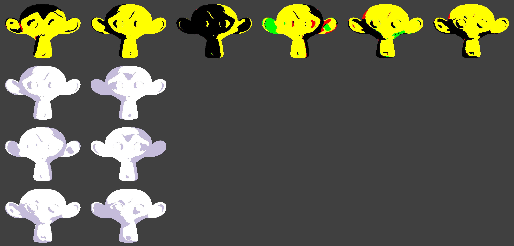

# Face SDF node: results (2026-10-14)

## What it is

`Malt/Pipelines/NPR_Pipeline/Shaders/NPR_Pipeline/FaceSDF.glsl` adds two nodes in the Shading category:

- **Face SDF**: lit / shadowed for the face from an angle-encoded SDF texture, plus the horizontal light angle and
  elevation in head space. For custom graphs.
- **Pixel Cel Face SDF**: drop-in for Pixel Cel on the face material. Same colour inputs (base, shadow tint or hue
  shift) and the same outputs (color, line_color, line_data, tone, shadowed). Two tones only.

The texture comes from CL SDF Tools, Pixelizer fork (Pixelizer `third_party/src/cl_sdf_tools`, README section
"Pixelizer fork changes"): `T_Face_SDF_Pitch.png` (R = level, G = above, B = below) and `T_Face_SDF_Pitch_Flip.png`.
With **Pitch Levels** off, any single-channel CL SDF texture works (only R is read).

## Rules

- Lit when `sdf > 0` and `sdf >= 1 - h / 180` (h = horizontal angle folded to 0..180, 0 = behind, 180 = front).
  Export the SDF with Invert on (the add-on default).
- h > 0 (light on the head's left, +X of a -Y facing head) reads the main texture, h < 0 reads the Flip texture.
- Elevation e blends channels: `mix(R, G, e / above_angle)` above, `mix(R, B, -e / below_angle)` below.
- Texels are read exactly (texelFetch), so the edge is hard. No smoothing input, by design.
- Head frame: **Use Object Axes** (default) takes -Y forward, +Z up from the object matrix. An armature-deformed head
  does not move the object matrix: turn it off and feed Head Forward / Head Up (world space, for example by drivers
  from the head bone).
- Cast shadows from other objects (hair) still apply (`shadows`). Self shadows are off by default, because removing
  the nose and cheek self-shadow noise is the point of a face SDF.

## Test

Setups `face_sdf_*`, `face_cel_*`, `face_plain_*` in `tools/pixelart/scenes.py`, one launch:

    RENDER_TIMEOUT=900 bash tools/pixelart/render.sh <testmalt.blend> OUT 1 face_sdf_l120,...,face_plain_r120
    python tools/pixelart/face_sdf_check.py OUT

Test SDF: Suzanne from `testmalt.blend`, made headless by the add-on with no painting (Pixelizer
`content/malt/face_sdf/suzanne`, 1024 px, 15 deg steps, 16 bit, pitch 45/45). Unpainted, the SDF is N.L > 0 at the
sampled angles, so the debug material (R = Face SDF lit, G = N.L > 0) must agree.

| Setup | Light (h, e) | Disagree |
|---|---|---|
| l120 | 120, 0 | 0.29 % (terminator pixels) |
| l60 | 60, 0 | 0.30 % |
| u45 | 120, +45 | 0.97 % |
| d45 | 120, -45 | 1.01 % |
| u30 | 120, +30 | 4.49 % (between two levels: blending two SDF values is an approximation) |
| r120 | -120, 0 | 13.57 % (Flip side: ears and eye sockets only, see below) |

r120: the Flip texture assumes a left/right mirrored UV layout. Suzanne's UVs mirror for only 92 % of the texels; all
disagreement is in the ears and eye sockets, the head and face areas agree. Use mirrored UVs on real faces.

Row 1: debug renders d45, l120, l60, r120, u30, u45 (yellow = both lit, black = both shadow, red / green = disagree).
Rows 2-4 (l120, r120, u45): Pixel Cel Face SDF (left) next to plain Pixel Cel (right). Same colours; the plain one
shows the brow and nose self-shadow islands that the face SDF removes.

## Test tooling changes

- `render_gui.py`: a setup may return a callable. It runs once the materials are compiled, then the wait starts again.
  Needed because shader-source uniforms (`material.malt.parameters`) exist only after a compile.
- Malt hides all-caps uniforms as private: name texture uniforms in lowercase in test shaders.
- `face_sdf_cel.mesh.glsl` (plain side) calls `pixel_cel` with the working-tree signature (`outline_shadow_only`,
  uncommitted on 2026-10-14). Update the call if that change is dropped.

## Open

- Painted SDF on a real character face (the point of the tool), and head-bone axes through drivers.
- Light from straight above or below: the horizontal angle is undefined there; the G / B channel decides alone.
